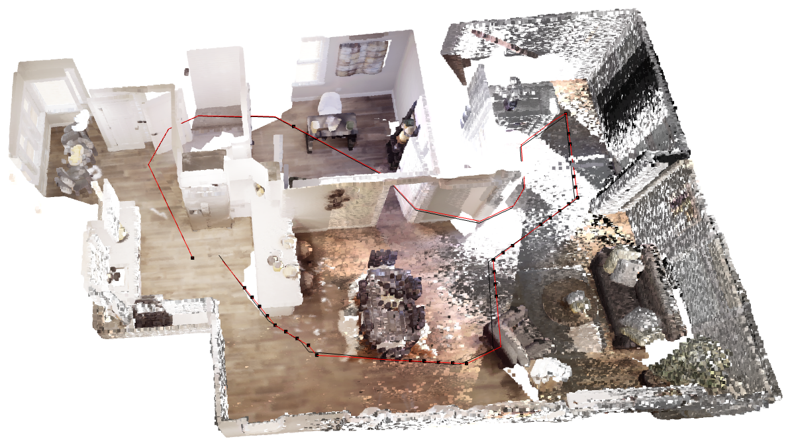
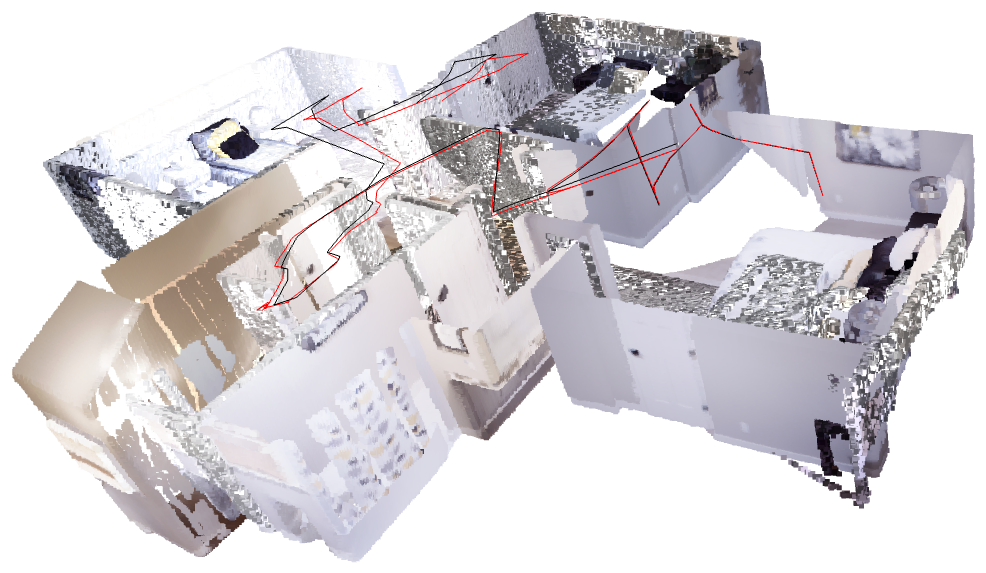
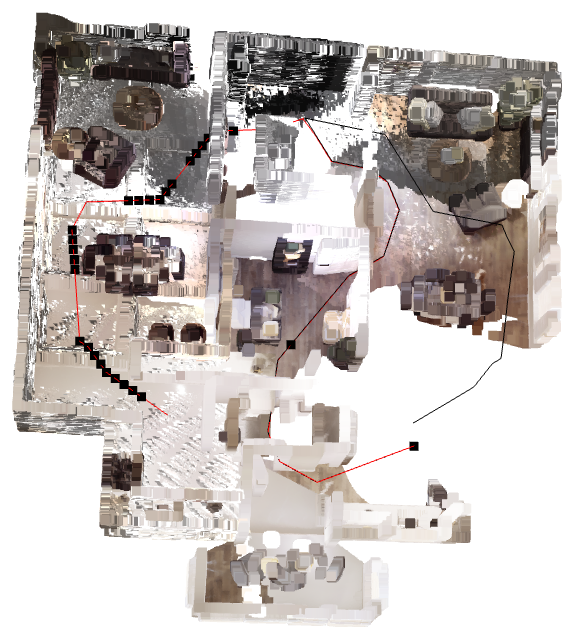
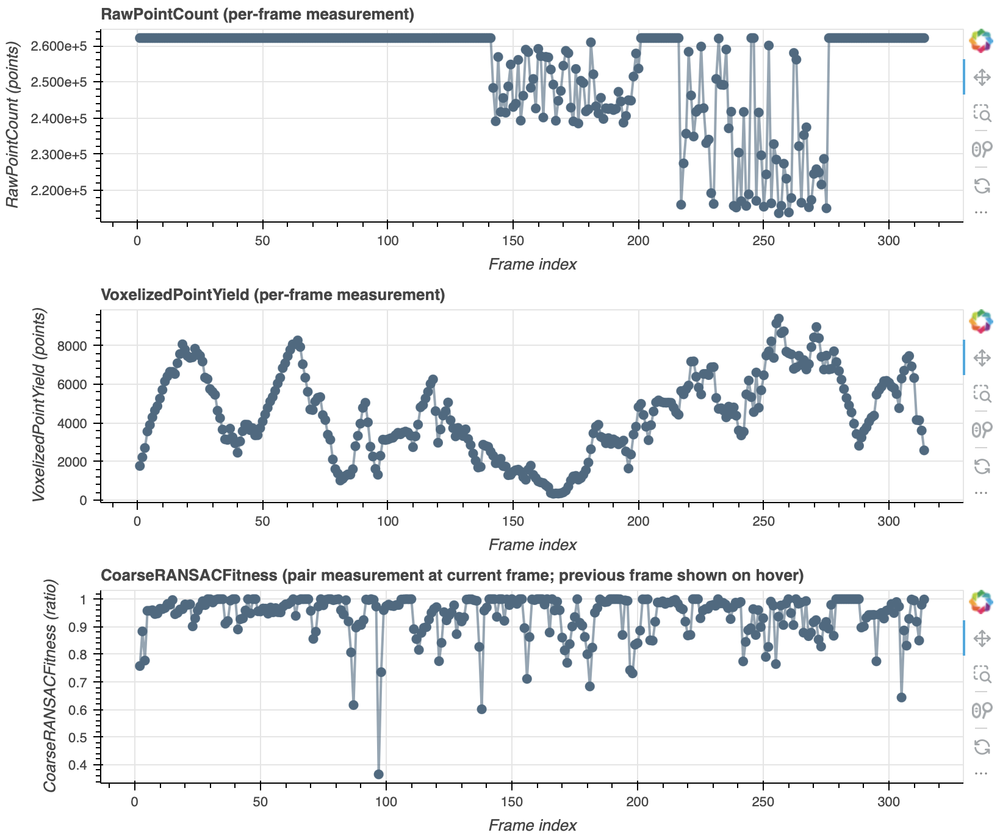

# 3D Scene Reconstruction (HW1)

Homework 1 for Physical AI (TAICA, Fall 2026). Frame-to-frame RGB-D reconstruction of Replica
apartment_0 in Habitat-Sim, with a data-verification workflow.

Built on the course template, [HCIS-Lab/physicalai26-hw](https://github.com/HCIS-Lab/physicalai26-hw).
The implementation is in `utils.py`. The other files are from the template. Setup steps are in `docs/setup.md`.

## Pipeline

Depth unprojection, voxel downsampling with normals and FPFH, RANSAC, point-to-plane ICP, pose
chaining, then the map and Mean L2 against ground truth.

Voxel size is 8 cm (`--voxel-size 0.08`). Two changes go beyond the required TODOs. Both can be
switched off at the top of `utils.py`:

- `IDENTITY_HYPOTHESIS`: ICP also runs from the identity. The smaller motion is kept unless the
  larger one has fitness higher by `FITNESS_TIE` (0.02) and RMSE within `RMSE_SLACK` (1.1x).
- `YAW_ONLY`: the Habitat agent only turns about the vertical axis, so ICP is kept to yaw and
  translation (one ICP step, project the rotation, repeat).

## Run

```bash
git submodule update --init
pixi install -e habitat
pixi run -e habitat python api.py declare --name <exp> --data-dir <capture_dir> --floor <1|2>
# fill in the label and prediction in experiments/<exp>/<exp>.ttl
pixi run -e habitat python reconstruct.py --experiment experiments/<exp>/<exp>.ttl --voxel-size 0.08
pixi run -e habitat python reconstruct.py --experiment experiments/<exp>/<exp>.ttl --voxel-size 0.08 \
  --selection-query experiments/<exp>/queries/frames.rq --override-experiment
pixi run -e habitat python api.py explore experiments/<exp>
```

## Results

| Floor | Frames | Mean L2 |
|---|---|---|
| 1 (provided capture) | 191 | 0.074 m |
| 2 (own capture) | 314 | 0.163 m |

Red is the estimated path and black is ground truth.

Floor 1, 0.074 m:



Floor 2, 0.163 m:



Floor 1 on the first pass, before the fixes (3.174 m). One pair registered about 180 degrees wrong and the paths split there:



Measurements for the floor 2 capture. The drop in VoxelizedPointYield around frames 165-171 is a turn in front of a flat white wall, and most of the path error starts there:



The full write-up is in `report.pdf`. The capture data and Replica assets are not in this repo.

The custom ICP bonus was not attempted.
